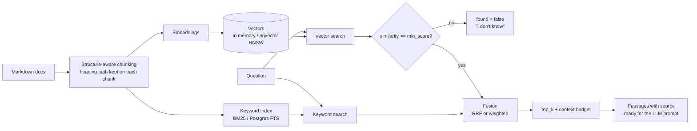

# rag-hybrid-search

[](https://github.com/prakash6018/rag-hybrid-search/actions/workflows/ci.yml)

Hybrid retrieval for RAG (vector + keyword search, fused) with the part most demos skip: **knowing when not to answer**, and **measuring retrieval quality** with golden questions.

```text
Q: How long until I get my refund?
   -> [returns / Returns and refunds > Refunds] score=0.99
      Refunds go back to the original payment method within 5 to 7 business days ...

Q: What is the capital of France?
   -> not found (no passage reached min_score=0.1). The assistant should say it doesn't know.
```

## Why

A RAG system that always returns *something* will confidently answer questions its documents don't cover. Rank fusion makes this worse: it scores the top result highly whatever it says. This project adds a similarity gate before fusion, and an evaluation harness so a change to chunking, models or thresholds is measured instead of eyeballed.

## How it works



- **Chunking** keeps each passage under its headings (`Returns > Refunds: ...`), so it still makes sense when retrieved alone. Long sections split with overlap. Unchanged documents are skipped by content hash.
- **Hybrid search** takes candidates from both vector similarity and keyword search. Keywords catch exact terms such as product names and codes; vectors catch paraphrases.
- **The gate** keeps only vector candidates with cosine similarity of at least `min_score`. If none pass, keyword-only matches are dropped too and the result is `found: false`.
- **Fusion** uses Reciprocal Rank Fusion, normalised to 0..1, or a weighted mix of min-max-normalised scores.
- **Retrieval profiles** bundle mode, fusion, candidates, `min_score`, `top_k` and context budget, so they can be compared side by side.

## Evaluation

`data/golden.json` holds 15 answerable questions (each with the section that should be found) and 3 out-of-scope ones. `python -m scripts.demo` compares profiles:

| Profile | recall@k | precision@3 | MRR | abstain accuracy |
|---|---|---|---|---|
| hybrid (RRF), default | 1.00 | 0.50 | 1.00 | **1.00** |
| hybrid (weighted) | 1.00 | 0.48 | 1.00 | 1.00 |
| vector only | 1.00 | 0.52 | 1.00 | 1.00 |
| keyword only | 1.00 | 0.54 | 1.00 | 1.00 |
| hybrid, **no min_score gate** | 1.00 | 0.40 | 1.00 | **0.00** |

The last row is the point of the project: without the gate, every out-of-scope question gets an "answer".

Notes on reading the numbers:
- Each golden question has one correct section, so precision@3 is capped at about 0.33–0.5 by design. Recall and MRR are the headline metrics.
- The offline `HashingEmbedder` is deterministic but much weaker than a real model. `min_score=0.10` was chosen from measured scores for it: in-scope questions score at least 0.13, out-of-scope ones at most 0.06. A real model needs its own threshold. Re-run the evaluation after changing models.

## Run it

Library, demo and tests use only the Python standard library:

```bash
python -m scripts.demo
pip install pytest && python -m pytest
```

API, in memory:

```bash
pip install -r requirements.txt
uvicorn api.main:app --reload
curl -X POST localhost:8000/documents -H 'content-type: application/json' \
  -d '{"doc_id":"returns","markdown":"# Returns\n## Refunds\nRefunds take 5 to 7 days."}'
curl -X POST localhost:8000/search -H 'content-type: application/json' \
  -d '{"query":"when do I get my money back?"}'
```

With Postgres + pgvector (HNSW index for vectors, a generated `tsvector` column with a GIN index for keywords):

```bash
docker compose up -d
cp .env.example .env      # DATABASE_URL already points at the compose database
uvicorn api.main:app --env-file .env
```

Set `OPENAI_API_KEY` in `.env` to use `text-embedding-3-small` instead of the offline embedder. All settings are listed in [.env.example](.env.example); `.env` is git-ignored.

### Endpoints

| Method | Path | What it does |
|---|---|---|
| `POST` | `/documents` | Chunk, embed and index a Markdown document (skipped if unchanged) |
| `DELETE` | `/documents/{doc_id}` | Remove a document and its chunks |
| `POST` | `/search` | Hybrid search with an optional retrieval profile; returns passages and a ready-made `context` string |
| `POST` | `/evaluate` | Run golden questions against a profile; returns recall@k, precision@3, MRR, abstain accuracy and failures |

## Project layout

```text
ragkit/
  chunking.py    structure-aware Markdown chunking, content hashing
  embeddings.py  Embedder protocol, offline HashingEmbedder, OpenAIEmbedder
  keyword.py     BM25
  fusion.py      reciprocal rank fusion, weighted fusion
  retriever.py   hybrid retrieval, min_score gate, profiles, context budget
  evaluate.py    golden-question evaluation
  store.py       in-memory store
  pgstore.py     Postgres + pgvector store (same interface)
api/main.py      FastAPI service
scripts/demo.py  offline demo and profile comparison
data/            sample help-centre docs (fictional) and golden questions
tests/           pytest suite
```

## License

MIT
